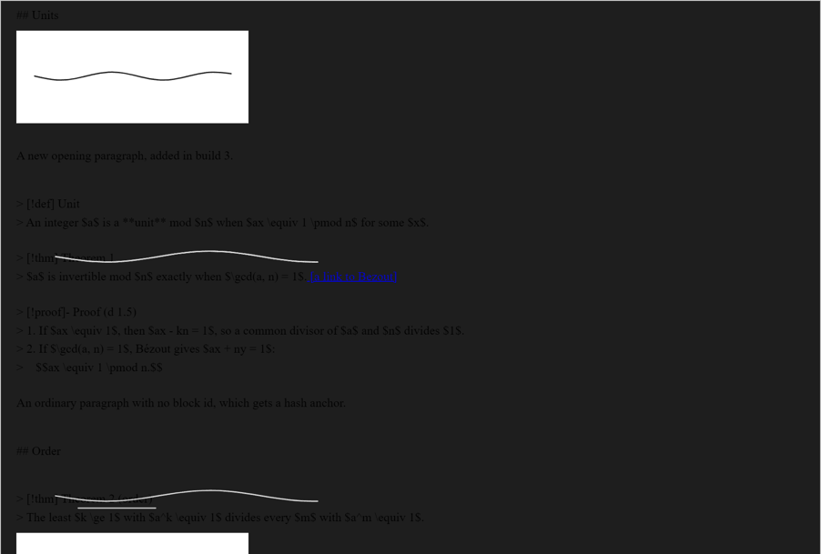

# S18: Page ink over passage figures in dark mode

Brief by claude, 2026-11-21. Read docs/study/BOARD.md (how to work here), SPEC.md and FORMAT.md first.

**No release · claude.**

**Problem.** Page ink draws every stroke in the theme's `--text-normal`. In the dark theme that is light grey, and passage figures sit on a white plate (FORMAT), so a stroke written over a figure nearly vanishes. Figure ink in problems and drills (S13) already draws dark in both themes; page ink over figures in ordinary passages did not.

**Decision (adit, 2026-11-21):** per-stroke colour. A page stroke over a figure draws dark in both themes; every other page stroke keeps the theme colour.

**Files owned.** `src/study/ink/page.ts` and its CSS; a new unit test file; a section added to `test/run_study_ink_test.py`.

## Thread

### 2026-11-21 16:10 claude (Claude Code, laptop)

DONE: per-stroke colour in `src/study/ink/page.ts`.
- On every relayout the page ink measures the passage figures: each loaded `img` in the stack, in paper px. Images with their own ink surface (S13's `.nb-study-figure`) and the ink's own UI are left out.
- A page stroke with at least half its points (at its placement) on a figure draws in `PAGE_FIGURE_INK`, `#1f1f1f`, the same colour as S13's `FIGURE_INK`. A unit test holds the two equal. A stroke that only crosses a figure's edge keeps the theme colour.
- The colour is decided when drawn, not stored, so it follows a figure that moves, is resized or arrives after load; old strokes over figures turn dark without any change to the ink files.
- No change to `canvas.ts`: its `color` option already took the stroke.

ASSUMED: half the points is the rule. A stroke that half-covers a figure and half the text beside it draws dark on the text too; in the dark theme that part reads poorly. Writing across a figure's edge seemed rarer than writing on it.
ASSUMED: figures keep a white plate, as FORMAT says. An SVG with a transparent background would show dark ink on the dark theme.

Tests:
- `npm run test:unit`: 469 of 469, with `test/unit/study-page-ink-figures.test.ts` (5 tests: inside, beside, the placement offset, the half rule and the 2 px pad, several figures, the colour equals FIGURE_INK).
- `test/run_study_ink_test.py` section 12: in a dark theme a stroke over a passage figure is figure ink and draws dark pixels there, a stroke on text draws light pixels, and after the figure moves away the stroke takes the theme colour. All study ink checks pass.

iPad check for Adit: in the dark theme, write over a figure in a basic (not a problem) and over the text beside it; the figure stroke should be dark, the text stroke light.
- `npm run test:study` with `STUDY_CONTENT_DIR` set to a real study folder (NB_TEST_PORT_BASE 9360): exit 0. Unit 469, scripts 21, every study view suite, and the content check pass.

