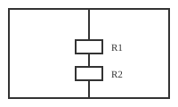

> Written by a model for Adit. Not Adit's words.

## Drills

> [!problem] The divider (d 1)
> The divider in the figure splits the supply. With $R_1 = R_2$, find $V_{out}$.
>
> 
>
> 
>
> 
^inv-s12-divider

> [!solution]- Solution
> methods: parity
> 1. Equal resistors split the supply: $V_{out} = V_{in}/2$.
> Answer: $V_{in}/2$.
